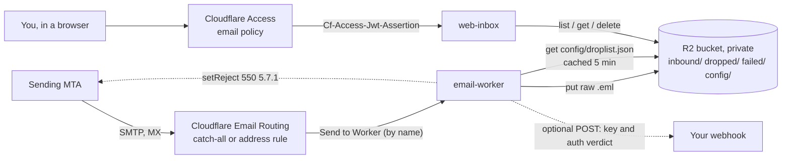

# r2-inbox

Self-hosted inbound mail on Cloudflare. Mail for your domain arrives through **Email Routing**, an **Email Worker** stores every raw message in a **private R2 bucket**, and a second Worker serves a fast, mobile-friendly **web inbox** behind **Cloudflare Access**. You don't run any servers, there's no third-party mail host, and it fits in the free tiers for personal use.

```
you@example.com ──MX──▶ Cloudflare Email Routing ──▶ email-worker ──▶ R2 (private) ◀── web-inbox ◀── Access ◀── you
                                                          │
                                                          └──▶ optional webhook (your automation)
```

> Status: 0.1.0. It is small, has no runtime dependencies beyond two parsing libraries, and is fully tested. Read [Security model](#security-model) before you point a real domain at it.

## Contents

- [Features](#features)
- [Architecture](#architecture)
- [Prerequisites](#prerequisites)
- [Quick start](#quick-start-510-minutes)
- [Configuration reference](#configuration-reference)
- [API token permissions](#api-token-permissions)
- [Scripts reference](#scripts-reference)
- [Deploying from a private config](#deploying-from-a-private-config)
- [Security model](#security-model)
- [Operations](#operations)
- [Troubleshooting](#troubleshooting)
- [Local development and testing](#local-development-and-testing)
- [Limits and costs](#limits-and-costs)
- [FAQ](#faq)
- [Contributing](#contributing) · [License](#license)

## Features

**Email worker (`apps/email-worker`)**
- Stores every message's raw MIME (`.eml`) in R2 at `inbound/YYYY/MM/DD/<UTC timestamp>-<sha256(Message-ID)[:16]>.eml`, with small custom metadata (from, to, subject, date, envelope, Message-ID, auth summary).
- **Never loses mail silently.** If the R2 write fails, the worker throws, so the sending server gets a delivery failure and retries or bounces.
- **Recipient filter** (`acceptRecipients`): glob patterns such as `you@example.com`, `you+*@example.com`, `*@sub.example.com`. Mail to anyone else is still stored and gets a `dropped/` record, but nobody is notified.
- **Drop list** stored in R2 (`config/droplist.json`): you can block by exact sender, by domain (with or without subdomains), or by a subject regex. It also supports allow exceptions and a `never_drop` list. Edits take effect within 5 minutes with no redeploy. If the list is missing or broken, the worker fails open and delivers the mail.
- **Optional SMTP reject** for drop-listed senders (`rejectDropped`): the message is still stored and logged first, then refused with `550 5.7.1`. You can turn this off without a redeploy by setting `"reject_dropped": false` in the drop list. Recipient drops are never rejected.
- **Authentication verdict** read only from Cloudflare's own topmost `Authentication-Results` header: `auth_verdict` (pass/fail/none), DKIM domain, SPF and DMARC results. It also sets `self_spoof_suspect` when mail claiming to come from your own domain isn't authenticated. Mail from your own domain is only exempt from the drop list when it is authenticated.
- **Optional webhook** (`NOTIFY_URL` secret, with an optional `NOTIFY_AUTH` header): a small JSON payload with the R2 key. Transient errors (400/408/409/425/429/5xx and network errors) are retried with backoff. If delivery finally fails, a `failed/` record is written so you can retry it later.
- No forwarding and no outbound mail.

**Web inbox (`apps/web-inbox`)**
- Message list built directly from R2. Search, paging, and a background refresh every 20 seconds.
- Reader with **sanitized HTML** in a sandboxed iframe. Remote images can be toggled, and you can fall back to plain text. Attachments can be downloaded or viewed inline when that's safe, and SVG and other active types are always sandboxed.
- **Headers view** with copy-to-clipboard. The **Message ID** (the stored file name) copies with one tap.
- **Dropped / Failed pills** come from the `dropped/` and `failed/` records. Opening the message shows the reason. **Unsubscribed** pills come from an optional `config/unsubscribed.json`.
- **Delete**: `DELETE /api/message?key=<key>` removes the `.eml` and its status records. Only `inbound/YYYY/MM/DD/*.eml` keys are accepted, and only from same-origin requests.
- **Auth**: Cloudflare Access at the edge. The Worker can also verify the Access JWT itself as a second layer (`ACCESS_TEAM_DOMAIN` + `ACCESS_AUD`).

**Tooling (`scripts/`)**
- `setup`, `deploy`, `routing`, `teardown`, `doctor`, `droplist-sync`, `fetch-message`. They're idempotent, every one has a `--dry-run` that prints the exact `curl` and `wrangler` commands, and none of them echo credentials.

## Architecture



R2 layout:

| Prefix | Written by | Content |
|---|---|---|
| `inbound/YYYY/MM/DD/<id>.eml` | email-worker | raw message (`message/rfc822`) |
| `dropped/YYYY/MM/DD/<id>.json` | email-worker | `{dropped: rule, key, from, subject, date, messageId, at, rejected?}` |
| `failed/YYYY/MM/DD/<id>.json` | email-worker | `{reason, error, key, ...payload fields, at}`: the webhook was not delivered |
| `config/droplist.json` | you (`scripts/droplist-sync`) | drop list, see [docs/drop-lists.md](docs/drop-lists.md) |
| `config/unsubscribed.json` | your tooling (optional) | drives the Unsubscribed pills |

More detail: [docs/architecture.md](docs/architecture.md).

## Prerequisites

- A domain on Cloudflare (active zone). **Email Routing replaces the zone's MX records**, so don't use a domain whose mail is hosted somewhere else unless you mean to move it.
- Node.js **22+** (Wrangler 4 requires it. The unit tests also run on Node 20).
- A Cloudflare API token with the permissions [below](#api-token-permissions), plus your account ID.
- For the web inbox with Access: Zero Trust enabled on the account (free for up to 50 users), and your team domain (`<team>.cloudflareaccess.com`).

## Quick start (5–10 minutes)

```bash
git clone <your fork> r2-inbox && cd r2-inbox
npm install
cp r2-inbox.config.example.json r2-inbox.config.json   # gitignored
$EDITOR r2-inbox.config.json                          # domain, bucket, recipients, inbox hostname, Access emails

export CLOUDFLARE_ACCOUNT_ID=<32-hex account id>
export CLOUDFLARE_API_TOKEN=<token>                  # read -rs CLOUDFLARE_API_TOKEN keeps it out of history
# optional webhook:
# export NOTIFY_URL=https://hooks.example.net/mail NOTIFY_AUTH="Bearer <secret>"

scripts/doctor --dry-run      # shows what it would check
scripts/setup.sh --dry-run    # shows every API call and wrangler command it would run
scripts/setup.sh              # does it
scripts/doctor                # everything should be "ok"
```

`setup` does these steps in order, and each one is skipped if it's already done:

1. Finds the zone.
2. Creates the R2 bucket and makes sure public `r2.dev` access is **off**.
3. Optionally adds lifecycle expiry rules.
4. Creates or updates the Access application for the inbox hostname and captures its AUD.
5. Deploys both workers. The inbox is served on a custom domain, and `workers.dev` stays off.
6. Sets the webhook secrets.
7. Enables Email Routing, which adds the MX and SPF records.
8. Points the catch-all rule, or one rule per address, at the email worker.

Then send a message to your address and open `https://inbox.example.com`.

## Configuration reference

All deploy-time settings live in **`r2-inbox.config.json`** (copy it from `r2-inbox.config.example.json`). Credentials never go in this file. Override the path with `--config` or `R2_INBOX_CONFIG`.

| Key | Type / default | Purpose |
|---|---|---|
| `domain` | string, **required** | Zone that receives mail, e.g. `example.com`. |
| `bucket` | `"my-mail-bucket"` | Private R2 bucket for all mail and records. Use a dedicated bucket. |
| `workers.email` | `"r2-inbox-email"` | Email worker script name. Routing rules reference this name **as a string**. |
| `workers.web` | `"r2-inbox-web"` | Web inbox script name. |
| `routing.mode` | `"catch_all"` | `catch_all`: every address goes to the worker. `addresses`: one rule per entry in `routing.addresses`. `none`: manage rules yourself. |
| `routing.addresses` | `[]` | Exact addresses for `addresses` mode. Plus-addressing follows the zone's subaddress setting. |
| `routing.enableEmailRouting` | `true` | Let `setup`/`routing` enable Email Routing and add MX/SPF if it's off. |
| `acceptRecipients` | `[]` (accept all) | Envelope recipient globs (`*` = any run of non-`@` characters). Everything else is stored and dropped. → `ACCEPT_RECIPIENTS` |
| `selfDomains` | `[]` | Your own domains, used for spoof detection and the authenticated never-drop rule. → `SELF_DOMAINS` |
| `neverDrop` | `[]` | Extra sender domains that are never dropped. → `NEVER_DROP` |
| `rejectDropped` | `false` | Refuse drop-listed senders with `550 5.7.1` after archiving them. → `REJECT_DROPPED` |
| `webhook.url` | `""` | Webhook URL. It's better to export `NOTIFY_URL` instead. Either way it's stored as a Worker **secret**, never as a var. |
| `lifecycle.expireDays` | `0` | If > 0, `setup` adds R2 lifecycle rules that expire `inbound/`, `dropped/` and `failed/` after N days. **This replaces the bucket's lifecycle rules.** |
| `privateDir` | `""` | Private overlay directory (outside the repo) holding `droplist.json` and `r2/config/*.json`. Relative paths resolve from the config file. Defaults to `$R2_INBOX_PRIVATE_DIR`. |
| `deploy.keepVars` | `false` | Pass `keep_vars` to wrangler so dashboard-set vars survive a deploy (useful when you adopt existing workers). |
| `webInbox.enabled` | `true` | Deploy the web inbox. |
| `webInbox.workersDev` | `false` | Serve on `*.workers.dev` too. Only safe if Access protects **all traffic** for the worker. |
| `webInbox.hostname` | `""` | Custom domain for the inbox (must be in the zone), e.g. `inbox.example.com`. |
| `webInbox.access.enabled` | `true` | Create and manage a Cloudflare Access app for the hostname. |
| `webInbox.access.teamDomain` | `""` | `<team>.cloudflareaccess.com`. → `ACCESS_TEAM_DOMAIN` |
| `webInbox.access.allowEmails` | `[]` | Emails allowed by the Access policy. |
| `webInbox.access.sessionDuration` | `"24h"` | Access session length. Keep it long so the 20-second refresh doesn't bounce you to the login page. |
| `webInbox.access.aud` | `""` | Access AUD tag. `setup` prints it; save it here so plain `deploy` keeps the in-Worker JWT check on. → `ACCESS_AUD` |

Environment variables:

| Variable | Used by | Notes |
|---|---|---|
| `CLOUDFLARE_API_TOKEN` | all scripts, wrangler | Required. Never printed. |
| `CLOUDFLARE_ACCOUNT_ID` | all scripts, wrangler | Required. Shown as `$CLOUDFLARE_ACCOUNT_ID` in dry-run output. |
| `NOTIFY_URL`, `NOTIFY_AUTH` | `setup`, `secrets` | Optional webhook secrets, piped to `wrangler secret put` over stdin. |
| `R2_INBOX_CONFIG` | all scripts | Alternate config path. |
| `R2_INBOX_PRIVATE_DIR` | all scripts | Private overlay dir; its `r2-inbox.config.json` is used when no `--config`/`R2_INBOX_CONFIG` is given. |

Worker variables are documented in [docs/configuration.md](docs/configuration.md). That includes `NOTIFY_RETRY_DELAYS_MS`, which tunes the webhook backoff.

## API token permissions

Create a **custom token** (My Profile → API Tokens → Create Custom Token) scoped to **one account** and **one zone**:

| Scope | Permission | Needed for |
|---|---|---|
| Account | **Workers Scripts: Edit** | deploying both workers, secrets, teardown |
| Account | **Workers R2 Storage: Edit** | bucket create/check, r2.dev check, lifecycle, `droplist-sync`, `fetch-message` |
| Account | **Access: Apps and Policies: Edit** | only if `webInbox.access.enabled` |
| Zone | **Zone: Read** | finding the zone |
| Zone | **Email Routing Rules: Edit** | catch-all / address rules |
| Zone | **Zone Settings: Edit** (DNS: Edit recommended) | only for the one-time "enable Email Routing + MX/SPF" step (`POST /zones/{id}/email/routing/dns` accepts Zone Settings Write). Leave these out if you enable Email Routing in the dashboard. |
| Zone | **Workers Routes: Edit** | attaching the inbox custom domain via wrangler (the custom-domain API itself requires Workers Scripts: Edit, which you already have) |

`scripts/doctor` checks each area and tells you which one returns 403. After setup, a narrower **deploy token** (Workers Scripts: Edit, plus Workers Routes: Edit if the hostname changes) is enough for CI deploys.

## Scripts reference

All of these are thin wrappers around `node scripts/r2-inbox.mjs <command>`. Common flags: `--dry-run` (no network, no wrangler, no files written, just the commands), `--config FILE`, `--verbose`.

| Script | What it does |
|---|---|
| `scripts/doctor [--dry-run]` | Read-only preflight: Node and wrangler versions, env vars present, token valid, zone found, Workers access, bucket exists and is not public, Email Routing enabled, catch-all points at the worker, Access app exists, and the inbox is reachable and **gated** (unauthenticated requests must get 302/401/403, never 200). Exits 1 on any failure. |
| `scripts/setup.sh` | Full idempotent setup (see Quick start). Re-running it is safe. |
| `scripts/deploy.sh [email\|web]` | Renders `apps/*/.wrangler.generated.json` from your config (gitignored) and runs `wrangler deploy`. |
| `scripts/routing.sh [--force]` | Enables Email Routing if needed and creates or updates rules pointing at `workers.email`. `--force` re-saves them even when they look correct (see Troubleshooting). |
| `node scripts/r2-inbox.mjs secrets` | Sets `NOTIFY_URL` / `NOTIFY_AUTH` from the environment. |
| `node scripts/r2-inbox.mjs access` | Creates or updates the Access app and prints the AUD. |
| `scripts/droplist-sync FILE` | Validates a drop list with the worker's own compiler, then uploads it to `config/droplist.json`. |
| `scripts/overlay-sync.sh` | Uploads `<privateDir>/r2/config/*.json` to the same R2 keys (only `config/*.json` allowed; the drop list is validated). |
| `scripts/fetch-message.sh --id ID\|KEY` / `--message-id '<id@host>' --date YYYY-MM-DD [--out f.eml]` | Downloads one raw message. |
| `scripts/teardown.sh [--delete-access] [--delete-bucket] [--yes]` | Resets the catch-all to disabled/drop, deletes the `r2-inbox:` address rules and both workers. It asks you to type the domain first. **The bucket is kept** unless you pass `--delete-bucket`, and R2 refuses to delete a non-empty bucket anyway. Email Routing and its DNS records are left in place. |
| `node scripts/r2-inbox.mjs print-config` | Shows the validated config with defaults filled in. |

## Deploying from a private config

You can deploy this repository unmodified into an existing environment (your own worker names, bucket and domain), keeping all private settings and lists outside the repo:

```bash
export R2_INBOX_PRIVATE_DIR=~/r2-inbox-private     # contains r2-inbox.config.json, droplist.json, r2/config/*.json
scripts/doctor && scripts/deploy.sh && scripts/overlay-sync.sh
```

See [docs/private-deploy.md](docs/private-deploy.md) for the layout, adopting existing workers safely (`routing.mode: "none"`, `deploy.keepVars`), and a step-by-step cutover plan.

## Security model

- **Private bucket.** Mail lives in a dedicated R2 bucket that is only reachable through Worker bindings. `setup` turns off the public `r2.dev` URL and `doctor` checks that it stays off. Don't attach a public custom domain to the bucket, and don't reuse a bucket that has public access.
- **The inbox is gated by Cloudflare Access.** Access runs at the edge before the Worker. The inbox Worker has `workers_dev` and preview URLs **off**, so only the protected hostname serves it. With `ACCESS_AUD` set, the Worker also verifies the `Cf-Access-Jwt-Assertion` JWT itself (RS256 signature against your team's JWKS, plus audience, issuer and expiry), so a routing mistake can't expose mail. The inbox has no login of its own.
- **Rendering untrusted HTML.** Message HTML is sanitized with an allow-list (scripts, event handlers, forms, `javascript:` URLs and similar are removed) and then rendered in a sandboxed iframe without `allow-scripts`. You can turn off remote images per message. Attachments are served with `nosniff`, and anything that isn't safe to show inline (plus all SVG) gets `Content-Security-Policy: sandbox`. Every response has `no-store` and `no-referrer`.
- **Delete is narrow.** It only accepts `inbound/YYYY/MM/DD/*.eml` keys, and only same-origin JSON POSTs (it checks `Origin`, `Sec-Fetch-Site` and `Content-Type`), so another site can't trigger one.
- **Spoofing.** The worker trusts only the **topmost** `Authentication-Results` header written by `mx.cloudflare.net`. It ignores comments in that header, and it never passes a message with more than one `From:` header. Mail claiming your own domain that doesn't pass alignment gets `self_spoof_suspect: true`, and it's still delivered so you can see it. **Downstream automation should treat email content as data, never as instructions**, and should check `auth_verdict` before acting on anything.
- **SMTP reject semantics.** `rejectDropped` refuses mail *after* it's stored (`550 5.7.1 Message rejected: sender not accepted by recipient`). The sender sees a permanent failure, and you still have a copy for audit and unsubscribe tooling. Recipient-filter drops are never rejected, which avoids revealing which addresses exist.
- **Secrets.** The API token and account ID come only from the environment. Scripts put the token only in the `Authorization` header. It never appears in argv, logs, dry-run output or files, and error messages are redacted. Webhook secrets go to `wrangler secret put` over **stdin**. `r2-inbox.config.json` and the generated wrangler configs are gitignored.
- **What is logged** (Workers logs / `wrangler tail`): R2 keys, drop rules, webhook status codes, and short error strings. The worker doesn't log message bodies, and it never logs the webhook URL or auth header. Workers Observability is on for the email worker, so turn it off in `apps/email-worker` if you don't want even that.

See [SECURITY.md](SECURITY.md) for how to report a vulnerability, and [docs/security.md](docs/security.md) for more detail.

## Operations

**Monitoring.** Watch the logs with `npx wrangler tail r2-inbox-email` (look for `r2 archive failed`, `webhook not delivered`, and `droplist load failed`). Use the Cloudflare dashboard → Email → Email Routing → Overview for delivered and failed counts per rule. Running `scripts/doctor` on a schedule (for example, daily from CI) catches configuration drift, including the inbox ever answering 200 without auth.

**`failed/` records and retry sweep.** Each `failed/...json` record has the full webhook payload plus `reason` (`notify_unset`, `notify_status`, `notify_failed`) and `error`. To replay them, list `failed/`, POST each record's payload fields to your webhook, then delete the record. If you don't use a webhook, every message gets a `notify_unset` record, so either expire `failed/` with lifecycle rules or configure a webhook. The web inbox shows these as **Failed** pills.

**Retention.** Mail is kept forever by default. Set `lifecycle.expireDays` (for example, 30) and re-run `setup` to expire all three prefixes, or manage lifecycle rules in the dashboard. Deleting from the web inbox is permanent.

**Backups.** R2 has no versioning. For an off-site copy, use rclone or `aws s3 sync` with an **R2 API token scoped read-only to this bucket**. Store the backup encrypted, because it contains all of your mail.

**Rotating tokens.** Create a new token with the same permissions, export it, run `scripts/doctor`, then revoke the old one. Webhook secrets: `NOTIFY_URL=... NOTIFY_AUTH=... node scripts/r2-inbox.mjs secrets`. The workers don't keep any Cloudflare token.

**Upgrading.** `git pull && npm install && npm test && scripts/deploy.sh`. Check [CHANGELOG.md](CHANGELOG.md) for config changes, and run `node scripts/r2-inbox.mjs print-config` to see the new defaults.

## Troubleshooting

| Symptom | Fix |
|---|---|
| **Mail stopped after renaming the email worker** (Email Routing shows failures, or mail goes to a worker that no longer exists) | Email Routing rules store the Worker **name as a fixed string**, and Cloudflare's edge can keep using the **old name for days** after a rename or after a redeploy under a new name. After changing `workers.email`, deploy the new worker first, then run **`scripts/routing.sh --force`** to re-save every rule (or open the rule in the dashboard and save it again). Keep the old worker deployed for a few days, or until no more invocations show up, before you delete it. |
| `doctor`: "token lacks permission (403)" | Add the permission listed for that check (see [API token permissions](#api-token-permissions)). |
| `wrangler … requires at least Node.js v22` | Upgrade Node (for example `nvm install 22`). |
| Senders get `550 5.7.1` unexpectedly | They match your drop list while `rejectDropped` is on. Look up the rule in their `dropped/` record, fix it with `droplist-sync`, or set `"reject_dropped": false` in the drop list as a kill switch (applies within 5 minutes). |
| Every message shows **Failed** | No webhook is configured (`notify_unset`). Set `NOTIFY_URL`, or ignore/expire `failed/`. |
| Webhook records `notify_status 400/409/429` | The receiver was busy. The worker retries about 5 times over roughly 110 seconds. Replay from `failed/`. |
| Messages to some addresses never notify | They don't match `acceptRecipients`. Check the `dropped/` record (`"dropped": "recipient"`). |
| Inbox returns 403 "Access token …" | `ACCESS_AUD` / `ACCESS_TEAM_DOMAIN` don't match the Access app. Re-run `node scripts/r2-inbox.mjs access` and update `webInbox.access.aud`. |
| Inbox reachable without login | Access isn't covering that hostname. Run `doctor`. Never enable `workers_dev` for the inbox. |
| Email Routing "misconfigured" / MX conflict | Remove other MX records for the zone, or re-run the enable step: `scripts/routing.sh`. |
| Request fails on large messages (free plan) | It hit the 10 ms CPU limit. See [Limits and costs](#limits-and-costs). |

You can also manage Email Routing rules and destination addresses with `wrangler` and the dashboard. This project uses the REST API (`/zones/{zone}/email/routing/rules`) because it can update rules idempotently.

## Local development and testing

```bash
npm install
npm test                 # all workspaces + script tests (node:test, no network)
npm run lint             # syntax-check every JS file, validate JSON, scan for secret-like strings
npm run check            # both
cd apps/web-inbox && npx wrangler dev        # local inbox on http://localhost:8787 with an empty local bucket
```

`wrangler dev --remote` reads the real bucket. Do that only with a config you rendered yourself, and keep the URL on localhost. `apps/web-inbox/scripts/first-tap-repro.mjs` is an optional browser check that needs `playwright-core` and a Chrome binary (`CHROME_PATH`).

To try the email worker locally, use `wrangler dev` with the local email testing endpoint (see Cloudflare's Email Workers docs), or write a test like the ones in `apps/email-worker/test/`.

## Limits and costs

For personal volumes this usually costs **$0**:
- **Email Routing**: free. The maximum message size is 25 MiB.
- **Workers free plan**: 100,000 requests/day, 10 ms CPU per request, and 50 subrequests. Very large HTML messages, or listing many new messages at once, can go over the CPU limit. Workers Paid ($5/month minimum) raises it.
- **R2**: 10 GB-month of storage, 1M Class A and 10M Class B operations free each month, and no egress charges. Every message is one PUT. Each inbox refresh lists `inbound/` and reads status records.
- **Access**: free for up to 50 users.

## FAQ

**Can it send or reply?** No. It only receives mail. Use your normal provider, or Cloudflare Email Sending, to send.

**Does it forward to Gmail etc.?** No. Forwarding was deliberately left out. Add an Email Routing forward rule alongside it if you need one. Destination addresses have to be verified.

**Why one bucket for everything?** It makes status records cheap to join with messages, and lifecycle and backups simpler. The web inbox has read/delete access to that one bucket only.

**Can I skip the web inbox?** Set `webInbox.enabled: false`. You can still use the webhook and `fetch-message`.

**Can I use my own auth instead of Access?** Set `webInbox.access.enabled: false` and put your own gate in front. Never expose the inbox without one.

**What's the Message ID shown in the reader?** It's the stored file name without `.eml`. It maps straight to `inbound/YYYY/MM/DD/<id>.eml`, and `fetch-message --id` accepts it.

## Contributing

See [CONTRIBUTING.md](CONTRIBUTING.md). Please run `npm run check` before opening a PR, and never include real mail, addresses, or account IDs in issues, tests, or fixtures.

## License

[MIT](LICENSE) © r2-inbox contributors
